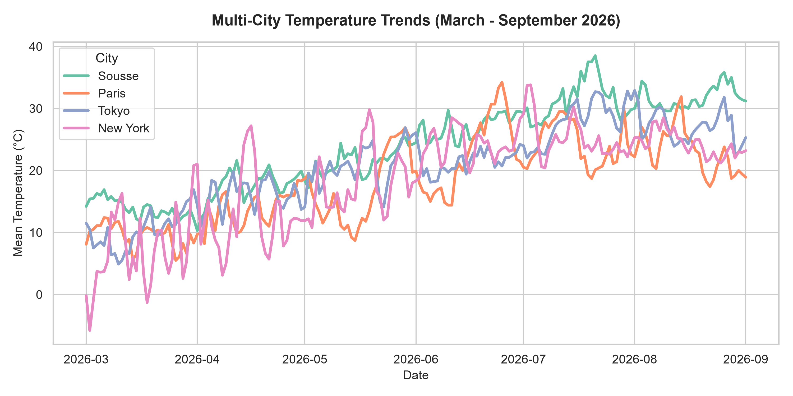
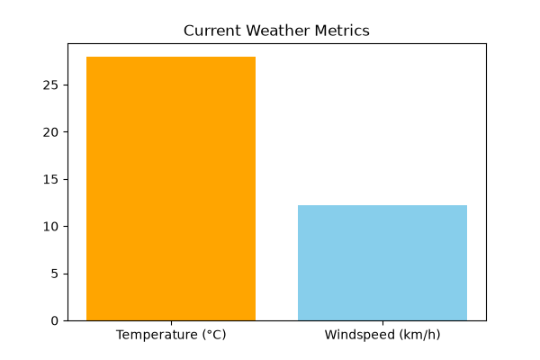

# 🌍 Mediterranean & Global Weather Data Pipeline

A small end-to-end data project: **extract** weather data from a public REST API, **transform** it with pandas, and **visualise** it as an interactive world map and static charts.

Built with Python, pandas, Plotly and Matplotlib on top of the free [Open-Meteo](https://open-meteo.com/) API (no API key required).

---

## ✨ What it does

| Stage | Description |
|---|---|
| **Extract** | Sends one batched request to the Open-Meteo **Historical Archive API** for 24 cities at once (comma-separated latitudes/longitudes). |
| **Transform** | Parses the JSON response, drops missing values, and computes each city's **mean daily temperature for June–September 2026**. |
| **Load** | Writes a tidy table to `global_weather_map_data.csv`. |
| **Visualise** | Renders an interactive Plotly `scatter_geo` map (`global_weather_map.html`) where marker colour and size encode mean temperature. |

### Cities covered (24)

- **Italy:** Rome, Milan, Venice, Naples
- **North Africa:** Tunis, Sousse, Sfax, Algiers, Casablanca, Tripoli, Cairo, Alexandria
- **France:** Paris, Marseille, Lyon, Toulouse, Nice
- **Rest of the Mediterranean:** Athens, Barcelona, Istanbul
- **Global reference points:** Tokyo, New York, Sydney, Reykjavik

The global cities act as a contrast to the Mediterranean ones. Over the period, the warmest city is **Cairo (30.9 °C)** and the coolest is **Reykjavik (10.4 °C)**.

---

## 📊 Outputs

### Interactive global temperature map
`global_weather_map.html` is a fully interactive map with hover, zoom and pan. GitHub doesn't render HTML files, so download it and open it in a browser.
<!-- Tip: enable GitHub Pages and link it here for a live demo -->

### Multi-city monthly trend
Monthly mean temperature, precipitation and max wind speed for **New York, Paris, Sousse and Tokyo** (March–September 2026). The data is in `multi_city_weather_summary.csv`.



### Current conditions snapshot
A live snapshot for Sousse (temperature, apparent temperature, humidity, precipitation). The data is in `clean_data.csv`.



---

## 🗂️ Project structure

```
api-data-project/
├── main.py                           # Archive API → mean temp per city → interactive map
├── global_weather_map_data.csv       # Tidy output table (City, Country, Lat, Lon, Mean_Temp)
├── global_weather_map.html           # Interactive Plotly map
├── multi_city_weather_summary.csv    # Monthly aggregates for 4 cities
├── multi_city_temperature_trend.png  # Trend chart
├── clean_data.csv                    # Current-conditions snapshot
└── weather_chart.png                 # Current-conditions chart
```

---

## 🚀 Getting started

```bash
git clone https://github.com/MedAzizHaffouz/api-data-project.git
cd api-data-project
pip install pandas plotly requests matplotlib
python main.py
```

The script regenerates `global_weather_map_data.csv` and `global_weather_map.html` in the project folder.

To analyse another period or other cities, edit `start_date` / `end_date` in `params` or add entries to the `cities` dictionary:

```python
"Sidi Bouzid": {"lat": 35.0382, "lon": 9.4849, "Country": "Tunisia"},
```

---

## 🛠️ Tech stack

- **Python 3**
- **requests**: HTTP calls to the REST API
- **pandas**: data wrangling and CSV export
- **Plotly Express**: interactive geographic visualisation
- **Matplotlib**: static charts
- **Open-Meteo API**: historical archive and forecast endpoints

---

## 🔭 Roadmap

- [ ] Add more variables (precipitation, humidity, wind) to the map with a dropdown selector
- [ ] Compare 2026 against multi-year averages to spot temperature anomalies
- [ ] Load the cleaned data into a SQL database and build a **Power BI** dashboard on top of it
- [ ] Schedule the pipeline to run daily (cron / GitHub Actions)

---

## 📜 Data source & licence

Weather data © [Open-Meteo](https://open-meteo.com/), licensed under [CC BY 4.0](https://creativecommons.org/licenses/by/4.0/).

## 👤 Author

**Mohamed Aziz Haffouz**, Business Computer Science student (Business Intelligence)
[LinkedIn](https://www.linkedin.com/in/CHANGE_ME/) · azizhaffouz101@gmail.com
